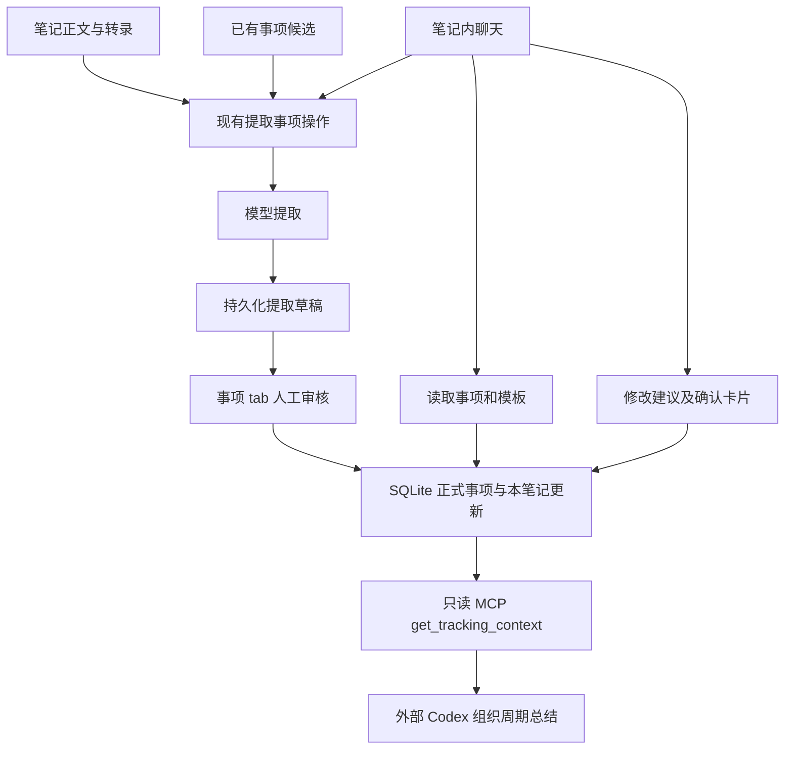
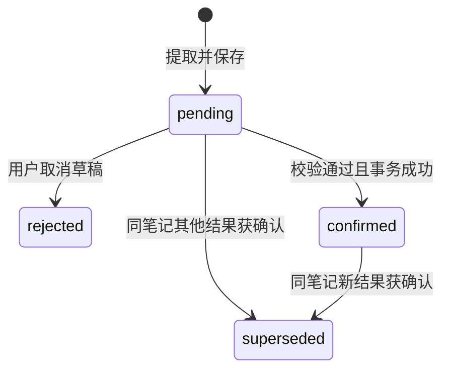

# SuperTing 事项机制：架构、决策与方案落地追踪

核对日期：2026-09-20。代码基线：本地 `main`，完整提交 `68aa953d5d7fa136970be6d2a6b827396f489d16`。本文描述该版本的真实行为，不把设计意图当作运行保证。文档编写时本地 main 领先远端两个提交，远端链接不作为代码已发布的证明。

入口：[领域术语](../../CONTEXT.md) · [架构决策 ADR-0001](../adr/0001-tracking-ledger-and-reviewed-extractions.md)。本文只追记、解释和识别缺口，不授权顺带修改实现。

## 1. 为什么需要这套机制

用户的核心诉求不是每周重新整理所有笔记，而是持续识别同一工作对象，并积累它的进展、风险与结果：

```text
原始笔记 = 事实来源
追踪事项 = 长期记忆
事项更新 = 每次记录的进展、风险、结果等
周期总结 = 基于事项更新生成的输出
```

业务上，商机赢单后进入项目交付，输单后停止跟进；产品能力可以独立记录，但优先关联正在推进的商机或项目来说明价值；生态合作重点跟踪合作项目。一个实际工作可以同时涉及商机和产品，不应被笔记的单一分类限制。内部管理和其他类别先不过度设计。

这些是用户目标。当前落地的是“人工审核的本地事项账本”，尚不是自动经营完整生命周期的工作代理。

### 1.1 设计演进与证据级别

| 阶段 | 会话中的决定或问题 | 可追溯实现 |
| --- | --- | --- |
| 记忆层调研 | 曾考虑外部 memory 工具和图索引，随后用户要求最小化 | 当前事项调用链未接入这些工具；不是宣称仓库没有原有向量检索 |
| 最小方案 | 笔记页面加「事项」tab；复用「操作」；提取必须落库；周报留在外部 | `174b0d9a` |
| 重复事项修复 | 同一笔记反复提取、模型换名导致重复；改用 ID 和显式新建确认 | `174b0d9a`，身份协议 v2 |
| 聊天方案 | 读取当前事项、读取模板、修改资料和本笔记进展、强制重新提取 | `68aa953d` |
| 本文 | 对照 main 源码追记，揭示未完成部分 | 文档基线如页首 |

此前产品方案主要存在本会话中，没有在当前 main 找到对应完整规格文件；上表和下一节是其归档摘要，不虚构原始方案文件或批准日期。另在历史 `memory-layer-research` worktree 找到 `docs/research/2026-08-25-memory-layer-options.md`，其中 Graphiti 等建议属于早期研究材料，未纳入当前 main；本文不把其推荐当作现行 ADR，也未重新核实外部产品现状。

## 2. 需求 → 当前实现 → 缺口

| 编号 | 已确认的需求 | 当前实现及边界 | 依据 |
| --- | --- | --- | --- |
| R01 | 不要每周失忆 | 事项 ID、跨笔记更新、持久提取记录；并非自动读取所有旧笔记 | S1、S2、T1 |
| R02 | 页面保持简单 | 笔记「事项」tab：提取、重提取、候选绑定、新建确认、进展和历史 | S3、T2 |
| R03 | 重新提取不能重复创建 | 已关联事项优先进入候选；模型输出 ID/ref；新建须明确选择 | S1、S2、S4、T1；不保证语义匹配百分百正确，用户仍可显式建重复项 |
| R04 | 追踪模板可配置、可供其他用户定义 | 四种内置模板有存储和读取；没有模板 CRUD/UI，提示词仍固定四种类型 | S1、S4、S5；部分实现 |
| R05 | 同一工作关联商机与产品 | 每个事项只有一个模板；多个事项之间以“关联”更新表达联系 | S1、S2；不是单事项多类型，也没有关联编辑界面 |
| R06 | 产品能力可独立、关联时说明价值 | 提示词允许独立产品工作；关联可带原文证据 | S4；没有强制要求每个产品项绑定项目 |
| R07 | 赢单转项目、输单停止追踪 | 只有状态文字及 `is_active` 字段；没有转项目、停用的写入流程 | S1；未实现自动业务规则 |
| R08 | 持续记录项目与生态合作进展风险 | 内置模板和更新类型支持人工提取/确认；没有自动定时追踪 | S1、S3 |
| R09 | 外部按日/周/月汇总，不内置周报模板 | MCP 可传范围读取；调用方组织报告；时间语义仍不完备 | S8、§7 |
| R10 | 聊天读取、修改、重新提取和查模板 | 工具已注册到有当前笔记的聊天上下文；修改须确认 | S5、S6、T3、T4 |
| R11 | 可追溯到笔记、证据和修改过程 | 更新保留 `note_id/evidence_text`，提取保留历史；没有原文版本快照；聊天确认回写审计不完整 | S1、S6、§8 |

## 3. 组件与数据所有权



Renderer 负责模型调用、展示和确认交互；preload 暴露 IPC；主进程 `DatabaseManager` 做持久化、归属校验和事务。聊天和事项页共享正式数据，没有独立的“聊天事项库”。原有 Qdrant/FTS 笔记搜索未用于这条事项候选召回链路。[S1、S4、S5、S6、S7]

### 3.1 四张表与两个状态概念

| 表 | 关键字段 | 所有权与语义 |
| --- | --- | --- |
| `tracking_templates` | `id/name/definition_json/version` | 定义字段、状态、更新类型；默认种子为商机、项目、产品能力、生态合作项目 |
| `tracking_items` | `id/template_id/title/state/properties_json/is_active/state_source_update_id` | 长期身份和当前资料；共享于多篇笔记。名称不是唯一键 |
| `tracking_updates` | `id/item_id/note_id/update_type/content/occurred_at/state_after/evidence_text/related_item_id/relation_type` | 当前生效的来源更新；关联也存这里 |
| `tracking_extractions` | `id/note_id/action_id/input_hash/template_version/result_json/status/supersedes_id` | 某次提取及其审核状态；不是正式事项当前值 |

`tracking_items.state` 是业务状态，如“投标中”；`tracking_extractions.status` 是审核状态，如 `pending`。不能将“风险识别”这一更新内容天然当作整个商机的新阶段。当前实现按非空 `stateAfter` 写入事项状态，并未严格验证状态是否属于模板枚举。[S1]

没有 `tracking_item_relations` 表，也没有单独的笔记—事项关系表：通过本笔记更新中的 `item_id` 加最新 confirmed 提取中的事项 ID 识别关联；无更新的事项也能显示。旧记录无 ID 时，仅在名称+类型唯一匹配时兼容识别。[S1]

迁移增加 `state_after`、`state_source_update_id`。后者没有外键约束，用来区分人工状态与进展派生状态；旧数据按同事项、相同状态的最新更新 ID 回填，是兼容推断，不是历史来源的严格证明。[S1]

## 4. 提取、缓存与身份

### 4.1 实际输入

- 模型事实输入为 `note.content` 加 `note.transcript`；有一个就能运行，两者均空则失败。结构化转录拼成带说话方的文本。[S4]
- `enhanced_content` 不作为此处的直接事实正文输入。标题、标签、增强内容参与候选召回和缓存指纹，不等同于完整传入模型；命中的候选仍会作为上下文提供。[S1、S4]
- 事项 tab 先 flush 待保存笔记，录音中可取实时转录；聊天入口读取已持久化笔记，没有同样的 flush/实时转录路径。两个入口并不完全等价。[S3、S6]
- 候选包含当前笔记已关联项，并返回全部启用中的已有事项；审核下拉框再按提议的事项类型过滤。候选召回不再按标题/正文相似度隐藏事项，避免笔记使用别名或简称时无法合并。不是向量检索或完整历史进展回忆。[S1]
- 提示词要求只用事实、原文短句证据、歧义进入 uncertainties，候选不作新证据；这些要求不是证据真实性的服务端验证。[S4]

### 4.2 身份协议 v2

`matchedItems/newItems` 中每项有草稿内 `ref`，已有项带 `itemId`；更新用 `itemRef`，关联用 `sourceRef/targetRef`。保存时删除模型自带的 `createNew`，归一化结果并写入 `protocolVersion: 2`。旧的 `itemTitle` 只有能唯一解析时才转为 ref。[S1、S2]

审核页为每个提议提供同类型候选和“新建”选择。确认时，主进程校验 ID 存在、模板类型匹配；无 ID 必须由审核结果明确设置 `createNew: true`。已有 ID 的正式名称优先，模型换个描述不会自动改名。`newItems` 只是模型提议分类，并不意味着最终一定新增。[S1、S3]

### 4.3 缓存与并发的真实边界

持久指纹为 SHA-256：标题、正文、增强正文、转录、标签、记录日期、操作 prompt、模板最大版本号。只查询同笔记/操作/指纹/模板版本的 pending 或 confirmed 最新记录；后台操作只复用 v2 结果。[S1、S9]

- 强制重新提取：`forceTracking=true` → 模型 → `saveTrackingExtraction(..., true)`，新增 pending；不立即清除旧进展。
- 普通后台提取：模型调用前检查缓存。
- 普通聊天提取：先调用模型，再由保存接口检查缓存；可能付出推理成本后返回旧结果。不要宣称所有入口都避免重复推理。
- 模板版本只是 `MAX(version)`，不是完整模板内容指纹；候选变化不在指纹里。
- 保存时根据当时数据库内容计算指纹，没有绑定请求起始快照。模型运行期间笔记被修改，可能出现结果与指纹不一致。
- 防重复执行用 Renderer 内共享 `processingFlags`；聊天和后台路径复用，但不是数据库唯一约束或跨窗口锁。

## 5. 审核与正式数据更新



重新提取新增一条记录，用 `supersedes_id` 指向前一 pending/confirmed；仅创建草稿时不会把前一结果立即改为 superseded。确认按当前指纹查出的记录 ID 做有效性检查，rejected/superseded 不可确认，已 confirmed 返回幂等成功。[S1]

确认事务依次：删除**本笔记**全部正式更新 → 查找/新建事项并写回 ID 和正式名称 → 将关系转成“关联”更新 → 插入更新及证据 → 更新事项状态 → 对已失去来源的状态回算 → 将同笔记其他 pending/confirmed 标为 superseded → 当前提取标为 confirmed。校验错误会回滚删除和插入；其他笔记的更新不被删除。[S1、T1]

注意：替换范围是整篇笔记，不按 action 隔离；本笔记原有人工修改过的进展也会在新草稿确认后被替换。未再出现的事项行不被删除或自动停用。现行状态以写入及 ID 顺序维护，不是按业务发生日期进行历史重放。

提取 `result_json` 在确认时会被写成审核后的内容，关系还会展开进 updates；它不是原始模型响应的不可变副本。旧记录改名时可能回填 ID，但保留提取文字。[S1]

## 6. 聊天、页面及 IPC 契约

| 聊天工具 | 输入 | 结果/副作用 |
| --- | --- | --- |
| `get_current_note_tracking` | 无；绑定当前笔记 | 正式 `items/updates`，最新提取状态和单独的 pending 草稿；不把候选当正式项、不自动提取 |
| `get_tracking_templates` | 无 | 数据库全部模板和解析后的 definition；只读 |
| `update_current_note_tracking` | `itemId`、可选 `updateId/itemPatch/updatePatch` | 要求先读；产生 confirmation metadata 和原值→新值卡片，不立即写库 |
| `run_note_action` | `actionId` 或 `actionName`，可选 `forceTracking` | 先确认操作，再执行；强制参数仅 tracking 操作接受；提取完成还需事项 tab 审核 |

只有传入 currentNote 时才注册这些事项工具；模型还须支持工具调用。工具能力存在，不等于所有模型每次都正确调用。[S5、S6]

修改白名单：事项 `title/state/properties`，当前笔记进展 `content/update_type/occurred_at/state_after`。属性浅合并，未提供的键保留；没有删除键语义。证据、类型、关系、删除和停用不在修改范围。[S1、S5]

确认 payload 携带读取快照 `expected.item/expected.update`。主进程事务重新读取并检查：事项已关联当前笔记、更新属于当前笔记与该事项、快照 JSON 相等、字段合法。进展类型按模板检查；发生时间要求日期形式且可解析；状态和自定义属性没有完整模板约束。[S1]

修改 `state_after` 仅在它是最新非空状态更新且也是 `state_source_update_id` 时同步当前状态；明确修改事项 state 优先，并清空来源 ID。状态来源清空后，旧进展修正不会覆盖人工状态。[S1、T1]

聊天确认前检查当前笔记 ID，已确认/取消或内存已处理的 tool call 不再执行。成功后数据库重新读取结果，Renderer 发 `superting-tracking-updated` 刷新事项页；正式卡片从 live items 读取，不用历史提取 JSON 充当现状。失败的同一卡片在当前 hook 生命周期内也被视为已处理，需要重新发起建议。[S3、S6]

IPC 统一经 preload → `ipcHandlers` → `DatabaseManager`，包含 `db-get-tracking-templates`、`db-get-note-tracking`、`db-get-tracking-extraction`、`db-save-tracking-extraction`、`db-confirm-tracking-extraction`、`db-reject-tracking-extraction`、`db-update-note-tracking`。聊天工具名与 IPC 名不是同一协议；本版没有对外开放事项修改 MCP。[S7]

## 7. MCP 与周期总结的时间语义

`get_tracking_context` 参数：`from/to/item_types/item_ids/include_relations/include_inactive`。返回范围和事项列表，每项有当前名称、当前状态、属性、更新及简单关联；更新含来源笔记 ID 和证据。默认只查询 `is_active=1`。[S8、S1]

必须向报告调用方说明：

1. from/to 是包含端点的字符串比较，过滤 `occurred_at`；NULL 日期始终保留，无更新项也可能保留。不是按提取日期或笔记日期归档。
2. 模型提取保存没有严格日期校验；“会议结束”等非日期字符串可能进入该字段。聊天修正路径的日期检查不能补齐历史数据。
3. 输出的事项状态是**现在**的状态，不是区间末状态；没有 `as_of` 或历史状态查询。
4. 如果一个事项只有区间外的非空日期更新，它可能整项缺席；不能当作完整进行中事项清单。
5. `include_relations` 在 schema 中声明，但 handler 未使用，关系仍按查到的更新返回。

Codex 的日/周/月总结应区分“范围内更新”“未知日期信息”“当前状态”，必要时回查笔记，不把未知日期算作本周新增。应用不存周报模板；更严格时间契约仍是待补齐能力。

## 8. 可追溯性与尚未闭合的边界

| 可追溯内容 | 当前保证 | 不应作出的承诺 |
| --- | --- | --- |
| 更新来源 | `note_id` 和 evidence 原文短句 | 没有原文版本、位置或真实性校验；笔记变更后不可保证逐字复现 |
| 提取演进 | 多条 extraction、supersedes_id、审核状态 | result_json 会被归一化/确认覆盖，不是完全不可变事件日志 |
| 事项延续 | ID 稳定、名称可改、旧名称唯一匹配回填 | 没有通用别名库、自动合并或完整实体消歧 |
| 聊天修改 | 内存卡片含变更和确认结果；数据库事务保存业务改动 | `patchToolCall` 只 setMessages，未持久化确认/取消后的 metadata；重载可能丢失终态，不能作为完整审计日志 |
| 模板变更 | 有 version 字段、读取工具 | 没有配置入口、动态模板提取与完整缓存失效策略 |
| 自动工作管理 | 手动提取并积累事项 | 没有定时运行、赢单转换、输单停用、风险自动闭环 |

建议后续按实际问题补齐：先处理聊天确认终态持久化与请求快照一致性，再统一日期契约和模板配置链路，最后落实商机生命周期。这里是差距清单，不是已排期或获授权的新实现。

## 9. 源码、测试与维护办法

所有相对链接基于本文所在仓库；需要复核历史行为时先执行 `git show 68aa953d:<path>`。函数名比浮动行号更适合作为长期定位点。

| 证据编号 | 文件与定位点 |
| --- | --- |
| S1 | [database.js](../../src/helpers/database.js)：建表/迁移、`_seedTrackingTemplates`、`getTrackingCandidates`、`saveTrackingExtraction`、`getNoteTracking`、`confirmTrackingExtraction`、`updateNoteTracking`、`getTrackingContext` |
| S2 | [trackingIdentity.js](../../src/helpers/trackingIdentity.js)：`normalizeTrackingDraft` |
| S3 | [TrackingPanel](../../src/components/notes/TrackingPanel.tsx)、[PersonalNotesView](../../src/components/notes/PersonalNotesView.tsx)：审核和 `extractTracking/flushPendingNoteSaves` |
| S4 | [noteActionInput](../../src/components/notes/noteActionInput.ts)、[runNoteActionOnce](../../src/stores/runNoteActionOnce.ts)：模型事实输入及身份协议 |
| S5 | [trackingChatTools](../../src/services/tools/trackingChatTools.ts)、[noteActionChatTools](../../src/services/tools/noteActionChatTools.ts)、[注册入口](../../src/services/tools/index.ts) |
| S6 | [useEmbeddedChat](../../src/hooks/useEmbeddedChat.ts)：`confirmToolCall/patchToolCall`；[聊天持久化](../../src/components/chat/useChatPersistence.ts)、[工具开关](../../src/components/chat/useChatStreaming.ts) |
| S7 | [preload](../../preload.js)、[IPC](../../src/helpers/ipcHandlers.js)、[接口类型](../../src/types/electron.ts) |
| S8 | [mcpServerManager](../../src/helpers/mcpServerManager.js)：`get_tracking_context` 注册 |
| S9 | [actionProcessingStore](../../src/stores/actionProcessingStore.ts)：缓存、forceTracking、共享执行标记 |
| T1 | [数据库测试](../../test/helpers/tracking.test.js)：缓存、同 ID 改名、显式新建、替换范围、旧记录、快照与归属检查、人工状态保护 |
| T2 | [事项页测试](../../test/components/trackingPanel.test.js)：空结果、疑点、拒绝记录、无进展的正式事项 |
| T3 | [聊天工具测试](../../test/services/trackingChatTools.test.ts)：真实读取、模板读取、先读后改和提议不写库 |
| T4 | [操作工具测试](../../test/services/noteActionChatTools.test.ts)、[后台提取测试](../../test/stores/trackingAction.test.js)：确认参数、强制提取和缓存 |

会话记录中的上一轮基线验证为 439 项测试通过，类型与 i18n 检查通过，lint 有 5 条已有 warning；这不等于本次文档工作重新执行了全套，也不证明真实模型端到端准确率。尤其聊天重载后的确认终态、模型推理期间改笔记、跨窗口并发、完整模板配置和周期时间语义，不能以现有单元测试宣称覆盖。

复核命令（使用 `.nvmrc` 对应 Node 24，依赖已准备时）：

```sh
node --test test/helpers/tracking.test.js test/components/trackingPanel.test.js test/services/trackingChatTools.test.ts test/services/noteActionChatTools.test.ts test/stores/trackingAction.test.js
npm run typecheck
npm run i18n:check
npm test
npm run lint
```

以后修改事项行为时，同步更新本页 R 编号状态、接口/数据语义、证据位置和基线提交；领域词义变化更新 CONTEXT，核心架构取舍变化新增 ADR 并引用旧决策。普通 bug 修复无需每次新增 ADR。
