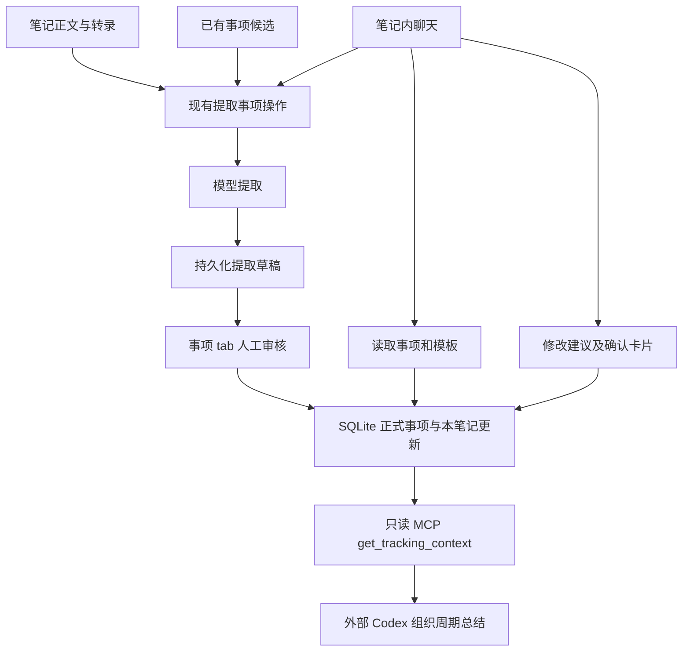
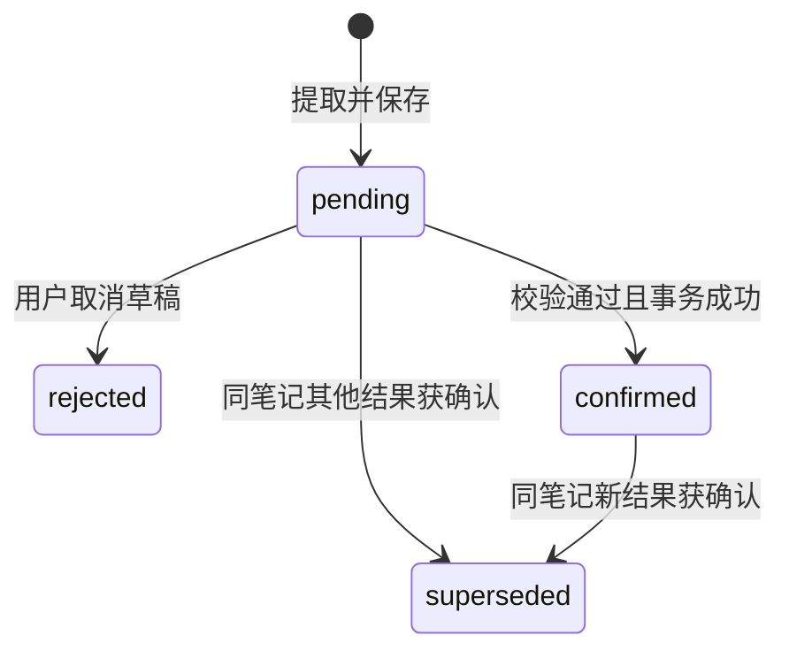

# SuperTing 事项机制：架构、决策与方案落地追踪

## 卡片内审核操作（已实现；基线 e63919c4）

共享 TrackingReview 移除全局搜索和原生 select。每张卡片使用现有 Popover/Input/Button 组成搜索下拉，按模板查询已有事项，支持分页、加载、空结果和失败反馈；查询与已选值分离，迟到响应不覆盖新查询。独立“新增”按钮只设置 createNew，正式写入仍走整篇确认事务。卡片右上角 X 移除本次草稿事项、其进展及引用它的关系记录，提供即时撤销；不删除正式事项，确认前不写数据库。刷新/切页前未确认的修改仍遵循现有临时审核语义，不增加自动保存接口。实际确认事务会将审核结果写回本条 result_json（不是永久保留未审核 JSON）；原始笔记和其他提取记录不变。本轮不改变此既有存储协议。

复用共享卡片的操作插槽，两处审核入口一致。沿用现有类型、重复名称和并发快照校验，不新增依赖、表、IPC 或 ADR。撤销仅恢复最近一次移除；再次修改关联或高级 JSON 后撤销入口清除，避免回滚后续修改。

验证：Node 24 下 464 项测试通过，typecheck、10 语言 i18n、renderer 构建通过；lint 无错误，3 条既有警告。新增测试覆盖按 ref 移除、双向关系清理、同名事项隔离、原对象不变、整篇审核实际落库与全部移除后正式事项保留。隔离浏览器夹具验证实时搜索、第 31 条分页及末页禁用、选择已有、新增、移除和撤销、替换勾选后确认退出队列、空结果、失败反馈、Esc 关闭，以及深色与 760px 窄窗口无横向溢出。弹层按视口可用高度限制，内部滚动，不遮掉底部分页。未操作真实用户数据；2026-09-22 发布前再次通过本地 CI，按用户授权进入 main 集成和本地安装流程。业务交互仍需原生 App 验收。

## 管理页面全宽布局（已实现）

后续扩展（基线 863f897c）：按用户要求，首页、一级聊天、上传、集成同样显式启用全宽布局。移除首页、上传内容与集成卡片的重复限宽；一级聊天通过 `ow-chat-workspace` 限定消息流与输入框的全宽覆盖，标题、消息流、输入区外边距均为 24px/16px。消息气泡仍限制 72ch，笔记内复用的聊天组件保留原样。无新增组件、依赖或业务逻辑变更。

扩展验证：462 项测试、类型检查、i18n、renderer 构建通过，lint 无错误、3 条既有警告。真实聊天布局组件的隔离预览实测：1440px 窗口标题与输入框左边距均为 24px，输入框宽 1392px；600px 窗口均为 16px，输入框宽 568px，均无横向溢出。其他三个页面完成源码布局检查与构建验证，尚未进行原生 App 逐页视觉验收。

审核搜索框（基线 863f897c）：复用 `ui/Input` 和现有图标库，统一高度、圆角、背景和 focus ring；搜索逻辑及候选事项查询不变。隔离待确认页实测搜索框与详情卡片左边界对齐，浅色主题下无默认橙色粗边。没有新增依赖或数据变更。

待确认审核工具栏（当前修复）：标题区只保留页面说明；Tab 与刷新/批量提取在同一工具栏，工具栏底部使用共享 border token 作为分割线。关联搜索候选在有关键词时只使用 IPC 返回的匹配项，清空关键词恢复初始候选，已选候选始终保留。没有新增状态、IPC 或数据库字段。

笔记列表事项状态（当前修复）：移除笔记列表中的“尚未提取/需重新提取/已确认”等摘要状态展示，同时移除仅为该展示服务的 `getNoteTrackingSummaries` 列表请求。事项状态仍在事项中心、笔记事项 Tab 和批量提取弹窗中展示；提取中的操作状态仍由现有操作状态组件负责。

基线 aebb6fb9。上一版将事项中心统一到 1024px 居中容器，大窗口出现过多外部留白。事项中心（包含待确认和模板）与词典/人名表改为显式使用共享 `ow-page-column--fluid`：填满工作区，默认左右 24px，小于 640px 时 16px。原 `ow-page-column` 默认规则保留，首页、聊天、上传和集成不受影响。事项列表保留 320px，详情占剩余宽度；继续沿用窄窗口列表/详情切换和待确认双栏响应式布局。没有进展时隐藏进展分页，没有关联或操作记录时隐藏对应空标题，日期与类型筛选仍保留。

实现仅涉及布局 CSS、两个页面及已有组件测试，不增加依赖、数据库或 IPC 变更。管理页面宽度与正文阅读宽度分别约束，不能再以统一字号为由统一所有页面的最大宽度。此为现有布局规范补充，无新增关键架构决策，无需新增 ADR。

验证：462 项测试、typecheck、i18n 与 renderer 构建通过，lint 无错误、3 条既有警告。隔离事项页面在 1920/1440/1024px 下实测左右 padding 24px，600px 下为 16px，均无横向溢出；检查了浅色详情与深色审核，空进展没有零条分页，空关联与操作标题不显示。词典复用同一修饰类；未对真实用户数据做修改。侧栏由外层提供，尚未单独完成原生 App 侧栏切换的视觉验收。

## 页面布局回归修复（已实现，未合并发布）

基线 1d88ffa9，codex/fix-workspace-layout。事项中心未使用 ow-page-title，受到未分层全局 h1 的 2.5rem 规则覆盖；页面也未复用 ow-page-column 的限宽居中规范。修复复用已有页面外壳、标题与工具栏，不修改全局标题规则。左右面板增加最小尺寸及独立滚动约束，属性过滤空值但保留 0/false，保留事项进展分组和审核协议。聊天页通过 ChatWorkspace 固定标题收缩规则、对齐消息区边距，并约束消息区独立滚动，不变更气泡设计。无数据迁移、无新依赖、无关键架构决策变化。

验证：Node 24.13.1，462 项测试通过；typecheck、i18n、renderer 构建通过，lint 0 错误、3 条既有警告。浏览器夹具检查了 313px 和 1440px 宽度及深色主题：事项标题 16px，桌面内容区最大宽度 1024px，窄窗口没有页面横向溢出。聊天夹具使用真实布局、消息区和输入组件，在 600px 高容器及超长内容下验证区域边界；修改前后均未复现截图中的顶部裁切，因此聊天部分属于布局加固，尚需原生 App 中复核用户场景。没有操作真实笔记或重新打包安装。

## 事项 UI 层级改造（已实现，未合并发布）

基线 a84f6793，分支 codex/tracking-ui-hierarchy。仅调整展示，不改数据库、IPC、审核事务或身份协议。

- U01：事项为独立主卡，进展在所属事项下缩进排列，以轻量时间线区别主卡。草稿按 itemRef，正式记录按 item_id 分组；名称不参与归属判断，无法归属的记录显式保留。
- U02：待确认和笔记审核复用同一组件；正式笔记与全局事项详情共用主卡/进展组件，保留发生日期、来源、证据和原有审核控制。
- U03：收紧标题工具栏，统一选中态、圆角、语义主题色、间距、长文本换行和窄窗口布局。沿用现有字体、图标、主题 token，不新增依赖或全局设计系统。
- U04：分组与渲染回归覆盖同名不同 ID、交错进展、无进展、未知归属；类型、i18n、完整测试及浅/深色页面验证后回填结果。

实现只抽取真正共用的事项展示模块和纯分组函数，不按旧方案为每个小标签新增组件。未改变关键架构决策，无需新增 ADR。默认不提交、合并或发布。

实际实现：`src/components/tracking/TrackingCards.tsx` 集中主卡、缩进进展容器和进展条目，复用于 TrackingReview、TrackingPanel、TrackingCenter。复用现有 card/muted/primary/border 主题 token；页面仅负责数据和布局，不新增页面专属颜色。纯函数 `groupTrackingUpdates.ts` 保持原事项顺序和各组更新顺序，不改原数组或正式关联；未知归属放到明确分区。审核仍整篇保存，不修改提交内容和归属逻辑。

本轮验证：Node 24.13.1，460 项测试通过，typecheck、10 语言 i18n、renderer 构建通过；lint 0 错误、5 条既有警告。分组测试覆盖同名不同 ID、交错更新、空进展、未归属和输入不变。隔离浏览器夹具验证了三个事项的分组、属性、证据、暂无进展、选择已有/新建与替换勾选后确认可用，以及浅色、深色、760px 窄窗口无横向溢出。没有操作真实用户笔记，未打包或做原生 App 验收。

## 批量提取与全局审核（2026-09-21，已实现，未合并发布）

基线 main `bc32dc35`，工作树 `codex/tracking-batch-review`。TC1 已在基线 main；本轮 B01–B06 在独立工作树实现，未提交、合并或打包。

- B01：事项中心按本地日期范围选择笔记，每页 50 条，跨页默认全选；空内容不可选，强制重提取可选。
- B02：复用后台操作串行执行，同笔记互斥；切页继续，停止只影响后续任务，失败可重试。批次仅会话内保存，退出后重新选择范围；草稿继续落 tracking_extractions，不加任务表。
- B03：全局队列只展示每篇最新 pending，复用笔记审核组件，普通卡片呈现内容/证据/疑点，逐篇确认与放弃。
- B04：请求开始固定输入和完整模板指纹，保存原指纹，过期草稿不可确认。旧 confirmed 继续可读，旧 pending 重提取。
- B05：审核预览比较正式事项与本笔记进展快照；替换需明确同意，事务内检测变化，同分类同规范名称新建冲突要求关联。
- B06：笔记列表批量读取持久摘要并叠加会话执行状态，失败不隐藏已确认结果。

接口：listTrackingSourceNotes、getNoteTrackingSummaries、listPendingTrackingNotes、prepareTrackingExtraction；保存增加请求指纹，确认增加审核快照与替换同意。所有应用内调用入口统一接入，不增加外部 MCP 写入。

验收：日期边界/跨页选择/删除与空内容、缓存与强制提取、执行中修改、旧数据兼容、切页/停止/失败重试/锁竞争、最新草稿过滤、并发确认/重名/幂等、两入口一致及其他笔记不受影响。使用既有测试、typecheck、i18n、完整测试。无需数据库迁移；旧二进制不理解新指纹，不支持跨版本同时写库。

核对日期：2026-09-20。§1–9 的功能代码基线为 `68aa953d5d7fa136970be6d2a6b827396f489d16`；本轮文档基于本地 main `c2486a009a87fdfa78a33aafbf0b64a03de574ef`（含前次架构文档，领先 origin/main 三个提交，用户已授权以该本地基线推进）。§10 为待实施设计，不把设计意图当作运行保证；远端链接不作为代码已发布的证明。

入口：[领域术语](../../CONTEXT.md) · [现行 ADR-0001](../adr/0001-tracking-ledger-and-reviewed-extractions.md) · [事项中心拟议 ADR-0002](../adr/0002-tracking-recoverable-changes.md) · [实施任务清单](../superpowers/plans/2026-09-20-tracking-center.md)。§1–9 中未特别标注的新旧差异以本页批量提取实施记录为准。

## 1. 为什么需要这套机制

用户的核心诉求不是每周重新整理所有笔记，而是持续识别同一工作对象，并积累它的进展、风险与结果：

```text
原始笔记 = 事实来源
追踪事项 = 长期记忆
事项更新 = 每次记录的进展、风险、结果等
周期总结 = 基于事项更新生成的输出
```

业务上，商机赢单后进入项目交付，输单后停止跟进；产品能力可以独立记录，但优先关联正在推进的商机或项目来说明价值；生态合作重点跟踪合作项目。一个实际工作可以同时涉及商机和产品，不应被笔记的单一分类限制。内部管理和其他类别先不过度设计。

这些是用户目标。当前落地的是“人工审核的本地事项账本”，尚不是自动经营完整生命周期的工作代理。

### 1.1 设计演进与证据级别

| 阶段         | 会话中的决定或问题                                              | 可追溯实现                                                 |
| ------------ | --------------------------------------------------------------- | ---------------------------------------------------------- |
| 记忆层调研   | 曾考虑外部 memory 工具和图索引，随后用户要求最小化              | 当前事项调用链未接入这些工具；不是宣称仓库没有原有向量检索 |
| 最小方案     | 笔记页面加「事项」tab；复用「操作」；提取必须落库；周报留在外部 | `174b0d9a`                                                 |
| 重复事项修复 | 同一笔记反复提取、模型换名导致重复；改用 ID 和显式新建确认      | `174b0d9a`，身份协议 v2                                    |
| 聊天方案     | 读取当前事项、读取模板、修改资料和本笔记进展、强制重新提取      | `68aa953d`                                                 |
| 本文         | 对照 main 源码追记，揭示未完成部分                              | 文档基线如页首                                             |

此前产品方案主要存在本会话中，没有在当前 main 找到对应完整规格文件；上表和下一节是其归档摘要，不虚构原始方案文件或批准日期。另在历史 `memory-layer-research` worktree 找到 `docs/research/2026-08-25-memory-layer-options.md`，其中 Graphiti 等建议属于早期研究材料，未纳入当前 main；本文不把其推荐当作现行 ADR，也未重新核实外部产品现状。

## 2. 需求 → 当前实现 → 缺口

| 编号 | 已确认的需求                       | 当前实现及边界                                                                           | 依据                                                           |
| ---- | ---------------------------------- | ---------------------------------------------------------------------------------------- | -------------------------------------------------------------- |
| R01  | 不要每周失忆                       | 事项 ID、跨笔记更新、持久提取记录；并非自动读取所有旧笔记                                | S1、S2、T1                                                     |
| R02  | 页面保持简单                       | 笔记「事项」tab：提取、重提取、候选绑定、新建确认、进展和历史                            | S3、T2                                                         |
| R03  | 重新提取不能重复创建               | 已关联事项优先进入候选；模型输出 ID/ref；新建须明确选择                                  | S1、S2、S4、T1；不保证语义匹配百分百正确，用户仍可显式建重复项 |
| R04  | 追踪模板可配置、可供其他用户定义   | 四种内置模板有存储和读取；没有模板 CRUD/UI，提示词仍固定四种类型                         | S1、S4、S5；部分实现                                           |
| R05  | 同一工作关联商机与产品             | 每个事项只有一个模板；多个事项之间以“关联”更新表达联系                                   | S1、S2；不是单事项多类型，也没有关联编辑界面                   |
| R06  | 产品能力可独立、关联时说明价值     | 提示词允许独立产品工作；关联可带原文证据                                                 | S4；没有强制要求每个产品项绑定项目                             |
| R07  | 赢单转项目、输单停止追踪           | 只有状态文字及 `is_active` 字段；没有转项目、停用的写入流程                              | S1；未实现自动业务规则                                         |
| R08  | 持续记录项目与生态合作进展风险     | 内置模板和更新类型支持人工提取/确认；没有自动定时追踪                                    | S1、S3                                                         |
| R09  | 外部按日/周/月汇总，不内置周报模板 | MCP 可传范围读取；调用方组织报告；时间语义仍不完备                                       | S8、§7                                                         |
| R10  | 聊天读取、修改、重新提取和查模板   | 工具已注册到有当前笔记的聊天上下文；修改须确认                                           | S5、S6、T3、T4                                                 |
| R11  | 可追溯到笔记、证据和修改过程       | 更新保留 `note_id/evidence_text`，提取保留历史；没有原文版本快照；聊天确认回写审计不完整 | S1、S6、§8                                                     |

## 3. 组件与数据所有权



Renderer 负责模型调用、展示和确认交互；preload 暴露 IPC；主进程 `DatabaseManager` 做持久化、归属校验和事务。聊天和事项页共享正式数据，没有独立的“聊天事项库”。原有 Qdrant/FTS 笔记搜索未用于这条事项候选召回链路。[S1、S4、S5、S6、S7]

### 3.1 四张表与两个状态概念

| 表                     | 关键字段                                                                                                     | 所有权与语义                                                           |
| ---------------------- | ------------------------------------------------------------------------------------------------------------ | ---------------------------------------------------------------------- |
| `tracking_templates`   | `id/name/definition_json/version`                                                                            | 定义字段、状态、更新类型；默认种子为商机、项目、产品能力、生态合作项目 |
| `tracking_items`       | `id/template_id/title/state/properties_json/is_active/state_source_update_id`                                | 长期身份和当前资料；共享于多篇笔记。名称不是唯一键                     |
| `tracking_updates`     | `id/item_id/note_id/update_type/content/occurred_at/state_after/evidence_text/related_item_id/relation_type` | 当前生效的来源更新；关联也存这里                                       |
| `tracking_extractions` | `id/note_id/action_id/input_hash/template_version/result_json/status/supersedes_id`                          | 某次提取及其审核状态；不是正式事项当前值                               |

`tracking_items.state` 是业务状态，如“投标中”；`tracking_extractions.status` 是审核状态，如 `pending`。不能将“风险识别”这一更新内容天然当作整个商机的新阶段。当前实现按非空 `stateAfter` 写入事项状态，并未严格验证状态是否属于模板枚举。[S1]

没有 `tracking_item_relations` 表，也没有单独的笔记—事项关系表：通过本笔记更新中的 `item_id` 加最新 confirmed 提取中的事项 ID 识别关联；无更新的事项也能显示。旧记录无 ID 时，仅在名称+类型唯一匹配时兼容识别。[S1]

迁移增加 `state_after`、`state_source_update_id`。后者没有外键约束，用来区分人工状态与进展派生状态；旧数据按同事项、相同状态的最新更新 ID 回填，是兼容推断，不是历史来源的严格证明。[S1]

## 4. 提取、缓存与身份

### 4.1 实际输入

- 模型事实输入为 `note.content` 加 `note.transcript`；有一个就能运行，两者均空则失败。结构化转录拼成带说话方的文本。[S4]
- `enhanced_content` 不作为此处的直接事实正文输入。标题、标签、增强内容参与候选召回和缓存指纹，不等同于完整传入模型；命中的候选仍会作为上下文提供。[S1、S4]
- 事项 tab 先 flush 待保存笔记，录音中可取实时转录；聊天入口读取已持久化笔记，没有同样的 flush/实时转录路径。两个入口并不完全等价。[S3、S6]
- 候选返回全部启用中的已有事项，已关联项优先；审核按类型过滤，并可搜索已有事项。正式关联项独立读取，停止跟踪不隐藏笔记中的正式结果。不是向量检索或完整历史进展回忆。[S1]
- 提示词要求只用事实、原文短句证据、歧义进入 uncertainties，候选不作新证据；这些要求不是证据真实性的服务端验证。[S4]

### 4.2 身份协议 v2

`matchedItems/newItems` 中每项有草稿内 `ref`，已有项带 `itemId`；更新用 `itemRef`，关联用 `sourceRef/targetRef`。保存时删除模型自带的 `createNew`，归一化结果并写入 `protocolVersion: 2`。旧的 `itemTitle` 只有能唯一解析时才转为 ref。[S1、S2]

审核页为每个提议提供同类型候选和“新建”选择。确认时，主进程校验 ID 存在、模板类型匹配；无 ID 必须由审核结果明确设置 `createNew: true`。已有 ID 的正式名称优先，模型换个描述不会自动改名。`newItems` 只是模型提议分类，并不意味着最终一定新增。[S1、S3]

### 4.3 缓存与并发的真实边界

持久指纹为 `v3:` + SHA-256：标题、正文、增强正文、转录、标签、记录日期、完整操作与完整模板内容。缓存必须是该笔记最新记录、相同操作与指纹的 pending 或 confirmed；仍只复用身份协议 v2 的结果。[S1、S9]

- 强制重新提取：`forceTracking=true` → 模型 → `saveTrackingExtraction(..., true)`，新增 pending；不立即清除旧进展。
- 普通后台提取：模型调用前检查缓存。
- 聊天、笔记与批量提取共用后台执行，调用模型前检查缓存。
- 完整模板内容进入指纹；候选变化不进入输入指纹，由审核时正式账本快照和重名检查处理。
- `prepareTrackingExtraction` 固定模型使用的输入及指纹，保存时携带同一指纹。执行期间内容变化仍保存草稿，但标记过期并禁止确认。
- 防重复执行用 Renderer 内共享 `processingFlags`；聊天和后台路径复用，但不是数据库唯一约束或跨窗口锁。

## 5. 审核与正式数据更新



重新提取新增一条记录，用 `supersedes_id` 指向前一 pending/confirmed；仅创建草稿时不会把前一结果立即改为 superseded。确认按当前指纹查出的记录 ID 做有效性检查，rejected/superseded 不可确认，已 confirmed 返回幂等成功。[S1]

确认事务依次：删除**本笔记**全部正式更新 → 查找/新建事项并写回 ID 和正式名称 → 将关系转成“关联”更新 → 插入更新及证据 → 更新事项状态 → 对已失去来源的状态回算 → 将同笔记其他 pending/confirmed 标为 superseded → 当前提取标为 confirmed。校验错误会回滚删除和插入；其他笔记的更新不被删除。[S1、T1]

注意：替换范围是整篇笔记，不按 action 隔离；本笔记原有人工修改过的进展也会在新草稿确认后被替换。未再出现的事项行不被删除或自动停用。现行状态以写入及 ID 顺序维护，不是按业务发生日期进行历史重放。

提取 `result_json` 在确认时会被写成审核后的内容，关系还会展开进 updates；它不是原始模型响应的不可变副本。旧记录改名时可能回填 ID，但保留提取文字。[S1]

## 6. 聊天、页面及 IPC 契约

| 聊天工具                       | 输入                                             | 结果/副作用                                                                           |
| ------------------------------ | ------------------------------------------------ | ------------------------------------------------------------------------------------- |
| `get_current_note_tracking`    | 无；绑定当前笔记                                 | 正式 `items/updates`，最新提取状态和单独的 pending 草稿；不把候选当正式项、不自动提取 |
| `get_tracking_templates`       | 无                                               | 数据库全部模板和解析后的 definition；只读                                             |
| `update_current_note_tracking` | `itemId`、可选 `updateId/itemPatch/updatePatch`  | 要求先读；产生 confirmation metadata 和原值→新值卡片，不立即写库                      |
| `run_note_action`              | `actionId` 或 `actionName`，可选 `forceTracking` | 先确认操作，再执行；强制参数仅 tracking 操作接受；提取完成还需事项 tab 审核           |

只有传入 currentNote 时才注册这些事项工具；模型还须支持工具调用。工具能力存在，不等于所有模型每次都正确调用。[S5、S6]

修改白名单：事项 `title/state/properties`，当前笔记进展 `content/update_type/occurred_at/state_after`。属性浅合并，未提供的键保留；没有删除键语义。证据、类型、关系、删除和停用不在修改范围。[S1、S5]

确认 payload 携带读取快照 `expected.item/expected.update`。主进程事务重新读取并检查：事项已关联当前笔记、更新属于当前笔记与该事项、快照 JSON 相等、字段合法。进展类型按模板检查；发生时间要求日期形式且可解析；状态和自定义属性没有完整模板约束。[S1]

修改 `state_after` 仅在它是最新非空状态更新且也是 `state_source_update_id` 时同步当前状态；明确修改事项 state 优先，并清空来源 ID。状态来源清空后，旧进展修正不会覆盖人工状态。[S1、T1]

聊天确认前检查当前笔记 ID，已确认/取消或内存已处理的 tool call 不再执行。成功后数据库重新读取结果，Renderer 发 `superting-tracking-updated` 刷新事项页；正式卡片从 live items 读取，不用历史提取 JSON 充当现状。失败的同一卡片在当前 hook 生命周期内也被视为已处理，需要重新发起建议。[S3、S6]

IPC 统一经 preload → `ipcHandlers` → `DatabaseManager`，包含 `db-get-tracking-templates`、`db-get-note-tracking`、`db-get-tracking-extraction`、`db-save-tracking-extraction`、`db-confirm-tracking-extraction`、`db-reject-tracking-extraction`、`db-update-note-tracking`。聊天工具名与 IPC 名不是同一协议；本版没有对外开放事项修改 MCP。[S7]

## 7. MCP 与周期总结的时间语义

`get_tracking_context` 参数：`from/to/item_types/item_ids/include_relations/include_inactive`。返回范围和事项列表，每项有当前名称、当前状态、属性、更新及简单关联；更新含来源笔记 ID 和证据。默认只查询 `is_active=1`。[S8、S1]

必须向报告调用方说明：

1. from/to 是包含端点的字符串比较，过滤 `occurred_at`；NULL 日期始终保留，无更新项也可能保留。不是按提取日期或笔记日期归档。
2. 模型提取保存没有严格日期校验；“会议结束”等非日期字符串可能进入该字段。聊天修正路径的日期检查不能补齐历史数据。
3. 输出的事项状态是**现在**的状态，不是区间末状态；没有 `as_of` 或历史状态查询。
4. 如果一个事项只有区间外的非空日期更新，它可能整项缺席；不能当作完整进行中事项清单。
5. `include_relations` 在 schema 中声明，但 handler 未使用，关系仍按查到的更新返回。

Codex 的日/周/月总结应区分“范围内更新”“未知日期信息”“当前状态”，必要时回查笔记，不把未知日期算作本周新增。应用不存周报模板；更严格时间契约仍是待补齐能力。

## 8. 可追溯性与尚未闭合的边界

| 可追溯内容   | 当前保证                                         | 不应作出的承诺                                                                                         |
| ------------ | ------------------------------------------------ | ------------------------------------------------------------------------------------------------------ |
| 更新来源     | `note_id` 和 evidence 原文短句                   | 没有原文版本、位置或真实性校验；笔记变更后不可保证逐字复现                                             |
| 提取演进     | 多条 extraction、supersedes_id、审核状态         | result_json 会被归一化/确认覆盖，不是完全不可变事件日志                                                |
| 事项延续     | ID 稳定、名称可改、旧名称唯一匹配回填            | 没有通用别名库、自动合并或完整实体消歧                                                                 |
| 聊天修改     | 内存卡片含变更和确认结果；数据库事务保存业务改动 | `patchToolCall` 只 setMessages，未持久化确认/取消后的 metadata；重载可能丢失终态，不能作为完整审计日志 |
| 模板变更     | 有 version 字段、读取工具                        | 没有配置入口、动态模板提取与完整缓存失效策略                                                           |
| 自动工作管理 | 手动提取并积累事项                               | 没有定时运行、赢单转换、输单停用、风险自动闭环                                                         |

建议后续按实际问题补齐：先处理聊天确认终态持久化与请求快照一致性，再统一日期契约和模板配置链路，最后落实商机生命周期。这里是差距清单，不是已排期或获授权的新实现。

## 9. 源码、测试与维护办法

所有相对链接基于本文所在仓库；需要复核历史行为时先执行 `git show 68aa953d:<path>`。函数名比浮动行号更适合作为长期定位点。

| 证据编号 | 文件与定位点                                                                                                                                                                                                                     |
| -------- | -------------------------------------------------------------------------------------------------------------------------------------------------------------------------------------------------------------------------------- |
| S1       | [database.js](../../src/helpers/database.js)：建表/迁移、`_seedTrackingTemplates`、`getTrackingCandidates`、`saveTrackingExtraction`、`getNoteTracking`、`confirmTrackingExtraction`、`updateNoteTracking`、`getTrackingContext` |
| S2       | [trackingIdentity.js](../../src/helpers/trackingIdentity.js)：`normalizeTrackingDraft`                                                                                                                                           |
| S3       | [TrackingPanel](../../src/components/notes/TrackingPanel.tsx)、[PersonalNotesView](../../src/components/notes/PersonalNotesView.tsx)：审核和 `extractTracking/flushPendingNoteSaves`                                             |
| S4       | [noteActionInput](../../src/components/notes/noteActionInput.ts)、[runNoteActionOnce](../../src/stores/runNoteActionOnce.ts)：模型事实输入及身份协议                                                                             |
| S5       | [trackingChatTools](../../src/services/tools/trackingChatTools.ts)、[noteActionChatTools](../../src/services/tools/noteActionChatTools.ts)、[注册入口](../../src/services/tools/index.ts)                                        |
| S6       | [useEmbeddedChat](../../src/hooks/useEmbeddedChat.ts)：`confirmToolCall/patchToolCall`；[聊天持久化](../../src/components/chat/useChatPersistence.ts)、[工具开关](../../src/components/chat/useChatStreaming.ts)                 |
| S7       | [preload](../../preload.js)、[IPC](../../src/helpers/ipcHandlers.js)、[接口类型](../../src/types/electron.ts)                                                                                                                    |
| S8       | [mcpServerManager](../../src/helpers/mcpServerManager.js)：`get_tracking_context` 注册                                                                                                                                           |
| S9       | [actionProcessingStore](../../src/stores/actionProcessingStore.ts)：缓存、forceTracking、共享执行标记                                                                                                                            |
| T1       | [数据库测试](../../test/helpers/tracking.test.js)：缓存、同 ID 改名、显式新建、替换范围、旧记录、快照与归属检查、人工状态保护                                                                                                    |
| T2       | [事项页测试](../../test/components/trackingPanel.test.js)：空结果、疑点、拒绝记录、无进展的正式事项                                                                                                                              |
| T3       | [聊天工具测试](../../test/services/trackingChatTools.test.ts)：真实读取、模板读取、先读后改和提议不写库                                                                                                                          |
| T4       | [操作工具测试](../../test/services/noteActionChatTools.test.ts)、[后台提取测试](../../test/stores/trackingAction.test.js)：确认参数、强制提取和缓存                                                                              |

会话记录中的上一轮基线验证为 439 项测试通过，类型与 i18n 检查通过，lint 有 5 条已有 warning；这不等于本次文档工作重新执行了全套，也不证明真实模型端到端准确率。尤其聊天重载后的确认终态、模型推理期间改笔记、跨窗口并发、完整模板配置和周期时间语义，不能以现有单元测试宣称覆盖。

复核命令（使用 `.nvmrc` 对应 Node 24，依赖已准备时）：

```sh
node --test test/helpers/tracking.test.js test/components/trackingPanel.test.js test/services/trackingChatTools.test.ts test/services/noteActionChatTools.test.ts test/stores/trackingAction.test.js
npm run typecheck
npm run i18n:check
npm test
npm run lint
```

以后修改事项行为时，同步更新本页 R 编号状态、接口/数据语义、证据位置和基线提交；领域词义变化更新 CONTEXT，核心架构取舍变化新增 ADR 并引用旧决策。普通 bug 修复无需每次新增 ADR。

## 10. 全局事项管理中心

状态：TC1 已在本地 main，GC01/GC02 的原生验证边界见 §10.8；GC03–GC06 未完整实现，GC07 的最新草稿队列/共享审核已在本轮 B03/B05 实现，回收站等关联能力未实现。§10.1–10.7 保留完整目标设计，实际接口/迁移和验证边界以 §10.8 为准。需求来自本会话用户明确追加的全局审核、进展编辑、删除、合并和模板编辑；以最后一次 ponytail review 精简后的方案为准。可恢复删除、无永久清空、同模板合并且不支持一键拆分，是本版公开的安全默认值。后续改变这些默认值需先更新设计。

### 10.1 范围与需求追踪

| 编号 | 本版能力与验收摘要                                               | 实施任务 |
| ---- | ---------------------------------------------------------------- | -------- |
| GC01 | 全局查阅所有正常事项及跨笔记更新，无进展事项不遗漏，支持来源往返 | TC1      |
| GC02 | 编辑名称、状态、属性及停止/恢复跟踪；共享笔记展示一致            | TC1      |
| GC03 | 编辑进展内容、类型、发生时间、stateAfter；证据和归属不变         | TC2      |
| GC04 | 删除与恢复事项/进展，历史替代记录不误恢复，原始笔记不删除        | TC2      |
| GC05 | 同模板合并，冲突预览、引用迁移、旧 ID 重定向，无自动语义去重     | TC3      |
| GC06 | 模板新增/编辑/停用/恢复/有限删除，动态提取与缓存真正生效         | TC4      |
| GC07 | 全局待审核队列复用笔记审核，确认前展示本笔记整体替换影响         | TC5      |

不包含：外部 MCP 写入、无来源的手工事项/进展录入、跨模板转换或合并、赢单自动转项目、周报模板、永久清空、自动拆分合并、图谱/看板/通用事件回放。停止跟踪不等于删除。明确要求的六类管理能力不因“最小化”移出本版。

### 10.2 页面和交互

主导航增加「事项中心」，含「事项 / 待审核 / 模板」三个 tab，右上角提供回收站入口。复用现有 ControlPanel 导航、UI 与 i18n，无新增依赖。

- **事项**：左列表右详情，窄屏切换；按名称搜索、模板 ID、实际状态、跟踪状态筛选，每页 30 条，默认全部未删除且未合并事项（含停止跟踪、无更新项）。按事项最近变动时间、ID 倒序。最近录入进展附它自身的记录时间，不能拼接事项资料修改时间冒充进展时间。
- **详情**：当前资料、分页进展、关联事项、来源笔记及简单操作历史。进展按创建时间、ID 倒序，同时展示业务发生时间；支持类型和日期筛选。关联查询包含入向/出向、保留方向与来源，不随进展翻页遗漏。
- **时间**：标准日期按本地日历日包含起止边界，带时区时间先换算；缺失/非标准旧日期单列“发生时间未明确”，过滤时仍单独可见，不算作区间内事实。日期过滤不让事项退出全局清单；不承诺当前状态是区间末状态。
- **编辑事项**：名称非空；新状态按当前模板校验，原有非标准值未修改可保留。属性局部更新，删除属性用明确的 removePropertyKeys，不用空字符串隐式删除；额外旧属性可见、不能丢失。提交前展示差异与“引用此事项的其他笔记也会变化”。
- **编辑进展**：允许 content/update_type/occurred_at/state_after；note_id、item_id、证据、关联两端不开放编辑。普通更新不得改成“关联”；关联记录本版只读、可整条删除。新设状态/类型按模板校验，未知发生时间用 null；未改旧值可保持。
- **往返**：笔记正式事项卡片按 ID 打开中心；中心按来源打开笔记「事项」tab。保留本会话筛选、页码、选中项；编辑未保存时提示保存/放弃/取消，遵守笔记原有保存保护。来源不存在或软删除时禁用跳转，不误开其他笔记。
- **刷新**：成功写入后重新读库并通知笔记页；复用 tracking 更新事件，进入/返回中心时再读取，提供刷新/重试。旧请求不得覆盖新选中项，加载、失败、空库与无匹配分别显示。

全局列表直接查询正式事项，不复用有限模型候选或 §7 的 MCP 范围接口。详情来源复用“本笔记当前更新 + 最新 confirmed 提取 ID”的规则；唯一名称+类型兼容解析不得猜同名项。以批量读取/必要 JSON 解析实现，不能逐笔记调用 getNoteTracking 反复查询全库。

### 10.3 审核、人工修改与状态

单次操作路径：读取真实记录 → 变更/影响预览 → 主进程事务比较快照 → 写入及操作留痕 → 重读与刷新。

- 普通编辑复用 expected 原值快照校验，不给所有表增加 revision 列。快照覆盖目标完整可变业务值；状态来源变动也必须比较。所有比较与写入在同一事务内完成，时间戳不是唯一并发凭据。
- 合并和审核比较预览所涉及记录的 ID 集合与可变值，必须检测新增、删除、重绑定；旧提取状态、笔记输入和模板指纹也参与审核检查。失败返回“数据已变化，请刷新”，保留用户编辑，不部分落库。
- 不为全部写接口设计统一请求 ID 框架。删除/恢复目标已达状态时幂等返回；审核检查提取状态；合并检查来源已指向同目标后幂等返回，若指向别处则冲突。普通重复编辑由原值校验阻止误覆盖，不以按钮禁用代替主进程保护。
- 明确设置事项状态建立人工状态保护；旧进展编辑、删除、恢复和重新审核均不得隐式覆盖。后续审核若建议改状态，须显式确认这项差异；确认采用新进展状态才重新建立来源。删除当前派生来源时，仅在其非人工状态下回算剩余有效来源；无来源采用模板默认状态。恢复旧记录不能无条件恢复旧状态。
- 全局修改走独立入口，笔记/聊天入口继续验证事项与笔记、更新与笔记的归属。共享底层校验、局部属性更新、旧记录改名补 ID 和状态维护，不复制另一套写逻辑，不放宽旧入口权限。

**重新提取不能无提示抹掉人工工作**：保留当前整篇笔记审核替换边界，但将物理删除旧进展改为标记 superseded，记录所属提取（可靠可得时）。旧记录含人工编辑/删除时，笔记审核与全局审核均显示替换影响，要求明确接受替换；不确认则当前数据不变。无论用户在哪个事项详情发起，替换的都是这篇笔记的有效更新，而不是某一事项子集。旧进展保留为历史，不计入 MCP 与当前时间线。

### 10.4 删除、恢复与合并

**事项删除**：设置 deleted_at，不逐条改变子更新删除状态；当前列表、候选和 MCP 隐藏该事项及涉及它的有效关系，原笔记不删。恢复事项后只显露原本有效的更新，不能连带恢复单独删除的更新。被合并来源不进入普通回收站，不能“恢复”成重复事项。

**进展删除**：设置 deleted_at，留存原值，按 §10.3 维护当前状态。恢复前检查父事项正常存在、记录未被新审核替代；父事项已删除要先恢复，superseded 更新只读历史不可直接恢复。关系删除用同一更新规则，保留证据。

**合并预览**：仅两个同模板、未删除未合并的事项，禁止自合并。默认保留目标名称/状态/跟踪标记，来源独有属性带入，同键不同值必须选择。展示受影响的笔记、有效与历史更新、关系数量及无进展关联；合并不是变更分类。

**合并事务**：将来源标记 merged_into_id；更新记录（包括删除/替代历史）的 item_id、related_item_id 迁移至目标，保留 note_id/证据。原归属在合并操作快照中保留。因合并产生的自关联退出有效集合并记原因，不硬删。不同更新不按内容相似度自动去重；展示重复关系可聚合但保留每条证据。目标状态取用户确认值，并设人工状态保护。

历史提取 JSON 不批量改写旧名称/证据，读取、绑定、审核和旧 ID 查询统一解析 merged_into_id 到最终目标，检测循环与无效目标。已合并源不可再作为新的来源；目标以后合并时允许形成可解析链。目标删除后旧 ID 解析也不可绕过删除限制。持久状态使重复合并只执行一次。

删除/合并 ID 可确定性拦截或重定向；无 ID 的新提议仍需审核。人工搜索可显式查回收站，展示恢复/历史匹配提示，不自动恢复或新建。不承诺能识别所有换名后的语义重复项。不提供通用撤销、合并拆分或永久清空。

### 10.5 模板与提取配置

模板支持名称、说明、文本属性字段（名称/说明/顺序）、状态列表与默认状态、更新类型。保留结构性“关联”类型用于既有关系协议，不作为普通进展类型互转。无公式、字段继承或通用动态表单引擎。

- 稳定模板 ID 是身份，name 仅为显示；保存模板内容时递增已有 version。旧属性按字段名存储，字段改名按新增/停用处理，不自动搬数据；删字段/状态/类型后旧值保留并提示，新设值须符合新定义。
- 停用后仍可读改已有事项，但不新建，不进入新模型提取配置。没有任何事项引用（包括删除和合并来源）的模板才能软删除；有引用只能停用。历史提取继续可读。恢复需满足名称唯一约束；默认模板种子不能因停用/改名/删除而重新生成一套，种子逻辑迁移为识别已完成初始化。
- 模型请求使用有效模板定义及 ID，而不是固定四种类型；新提取协议携带 templateId，旧名称协议仅唯一解析兼容。名称歧义、停用、删除或缺失模板不能在审核时静默猜测。
- 新请求记录笔记输入与模板配置快照/指纹；模板指纹包含有效 ID、名称、version、定义，替代 MAX(version) 作为新缓存判据。模型运行中笔记或配置变化，保存结果标为不可确认的旧输入草稿，不复用为当前缓存。旧无完整指纹的 pending 要重提取，旧 confirmed 仍用于历史和关联读取。
- 全局最新 pending 列表按笔记去重，旧 pending 只在历史展示；过期草稿保留并提示重提取。拒绝不影响正式进展。资料修改只要求重读绑定目标/影响预览，不一律重跑模型。
- 审核的人工候选搜索可分页查同模板全部正常事项（含停止跟踪并标注）；模型输入保持有界候选，不能把全库无上限塞入提示词。候选修复已在 main cef18a39；人工搜索与有界模型输入尚需分离。

### 10.6 持久化与接口（按任务增量实现）

继续 SQLite，扩展四表并新增一张简单操作记录表；不增加关系表、revision 全表改造、外部服务或事件回放系统。

| 表                        | 拟议新增/复用信息                                                                                        |
| ------------------------- | -------------------------------------------------------------------------------------------------------- |
| tracking_items            | deleted_at、merged_into_id、人工状态保护标记；复用 is_active 和 state_source_update_id                   |
| tracking_updates          | updated_at、deleted_at、superseded_at、extraction_id（可空）、人工编辑标记；关系因合并退出有效集合的原因 |
| tracking_templates        | is_active、deleted_at；复用 version，definition_json 扩展说明/字段定义/默认状态                          |
| tracking_extractions      | 请求输入和模板快照/完整指纹；复用现有 status，不增设一套审核状态机                                       |
| tracking_operations（新） | 操作类型、目标类型/ID、前后快照、来源入口、时间；记录与业务写入同事务                                    |

操作表保存编辑、删除、恢复、合并、模板变更和审核关键前后值及所涉 ID；不复制整篇笔记正文，不写凭据。普通查看不记日志。只做简单历史列表，不提供回放或自动撤销；审计记录不作为当前数据查询真源。首个编辑任务按需引入该表，后续扩展操作种类。

| 拟议应用内接口                                                               | 最小契约                                                                    |
| ---------------------------------------------------------------------------- | --------------------------------------------------------------------------- |
| listTrackingItems / getTrackingItemDetail                                    | 筛选/分页/总数；按 ID 读取实时资料、分页更新、关系和来源，旧 ID 返回规范 ID |
| updateTrackingItem / updateTrackingUpdate                                    | 目标 ID、expected 快照、白名单 patch；属性删除用显式键列表；返回重读数据    |
| deleteTrackingItem / restoreTrackingItem                                     | ID 与 expected，预览影响后事务执行                                          |
| deleteTrackingUpdate / restoreTrackingUpdate                                 | ID 与 expected，校验父事项/有效版本和状态来源                               |
| listTrackingTrash / listTrackingOperations                                   | 类型/目标筛选及分页，不混入正常查询                                         |
| previewTrackingMerge / mergeTrackingItems                                    | 来源/目标 ID、冲突选择及预览快照；规范目标 ID 与影响摘要                    |
| getTrackingTemplates / saveTrackingTemplate                                  | 复用读取；新增/修改时校验定义及 expected version，返回真实新版本            |
| setTrackingTemplateActive / deleteTrackingTemplate / restoreTrackingTemplate | ID、expected version；分别执行停用/恢复可用性、无引用删除及删除恢复         |
| listPendingTrackingNotes                                                     | 按笔记分页最新 pending，含过期原因和来源可用性                              |
| 既有确认/拒绝接口                                                            | 扩展审核影响预览与 expected，显式确认人工变更替换；复用笔记流程             |

不创建通用 deleteTrackingEntity 接口；实体规则不同。所有接口经 preload → IPC → 数据库事务，SQL 参数化，校验 ID、patch、日期、枚举与分页边界。UI 用原生日期输入和已有组件。旧 API 调用者必须一并适配审核保护，不能留一个无校验的旧确认通道。

需要同步核对的调用链：S1 数据库、S2 身份解析、S3 笔记审核、S4 提取输入、S5/S6 聊天、S7 IPC、S8 MCP、S9 后台缓存及新中心页面。有效更新查询统一排除删除/替代；正常事项查询排除删除/合并源；MCP 默认仍排除停止跟踪项，includeInactive 不能变成包含已删除项。

### 10.7 迁移、失败与交付

每阶段只加所需迁移与可用界面，不先搭全套基础设施。迁移前用 SQLite 一致性备份（不得只拷贝正在使用的主文件），迁移事务成功后才开启对应写入。失败关闭本次数据库连接并阻止写入，提供备份位置与真实错误；不能带着半迁移数据库继续运行。

旧数据默认未删除/未合并/有效；来源提取 ID 无法可靠还原则为空。旧人工状态保护只能依据既有来源信息尽力兼容，不能宣称找回全部人工修改历史。旧代码已经物理删除的进展无法恢复；旧被丢失的关系也不能补造。

不能简单降级旧 App 继续使用新库：旧查询不认识删除/替代标记。回退需要匹配版本与备份，恢复前再备份新库并提示会丢失备份后的工作；不得静默覆盖用户数据库。发布前在真实旧库副本验证升级和恢复流程，不直接拿用户唯一数据库试迁移。

验收案例与依赖见[任务清单](../superpowers/plans/2026-09-20-tracking-center.md)。最初设计阶段仅交付文档；TC1 验证见 §10.8，批量提取与全局审核验证见本页新增实施记录。本版阶段结果不自动发布；最终提交须 DCO，集成 main 使用 rebase/快进，打包另按发布规范授权。

### 10.8 TC1 实施记录（2026-09-21）

基线更新为获授权的 main `cef18a395bb1640dd62e10fe0e6428136d2cb9f6`；该阶段随后集成到本轮基线 main `bc32dc35`。下表保留 TC1 当时的验证记录，不代表本轮新增能力的测试结果。TC2–TC4 的完整功能仍未实现；TC5 中独立可用的审核能力由本轮提前实施。

实际实现：

- [TrackingCenter](../../src/components/TrackingCenter.tsx) 目前只有事项与只读模板两个 tab，不展示尚未实现的审核/删除/合并。支持 30 条分页、搜索/筛选、详情与证据、关系/来源、日期范围（未知日期单列标识）、名称/状态/字符串属性编辑、显式移除属性、停止/恢复跟踪、差异预览、冲突保留输入和刷新。历史非字符串属性只读保留，可显式移除；操作历史暂取最近 30 条，不是完整审计浏览器。
- `listTrackingItems`、`getTrackingItemDetail`、`updateTrackingItem` 已经 S7 接入；定义在 [tracking 类型](../../src/types/tracking.ts)。详情读当前表，规范 ID 合并解析尚属 TC3。`_saveTrackingItem` 被全局和笔记修改共用；全局用深比较 expected item 快照，笔记仍用既有 expected.item/update 与归属校验。快照比较和数据/操作记录写入同事务，事务内重读后才返回成功。
- 实际迁移仅 `tracking_items.manual_state` 和 `tracking_operations`（id/item_id/operation/before_json/after_json/entrypoint/created_at），没有其他删除/合并/版本字段。首次检测旧 tracking_items 无 manual_state 时，在任何初始化迁移之前执行 `VACUUM INTO`，备份在数据库旁 `.tracking-center-<时间>-<UUID>.bak`；失败关闭连接并抛错。字段与操作表创建在事务中。manual_state 的旧数据回填只推断“无状态来源且有非空状态更新”的情况，不是完备的人工编辑历史。
- 显式人工状态现在不被后续提取覆盖；更新自身的 state_after 仍保留事实。TC1 没有“审核时接受模型新状态”的按钮，只能人工编辑当前状态；TC2/TC5 再接入替换影响确认。旧进展仍被审核物理替换，不能宣称人工进展修正已受保护或回收站已可用。
- `getNoteTracking` 分离正式关联与 active 候选，停止跟踪项仍可在笔记读取/修改。无进展来源使用最新 confirmed ID，旧唯一名称匹配兼容。为旧来源仍需扫描最新 confirmed JSON；未做索引表，数据量变大时需测量再优化。
- 笔记正式卡片通过事件打开中心；中心打开来源时传入 tracking 初始视图。`useFolderManagement` 保留请求的来源 ID，`PersonalNotesView` 单独读取未在前 50 条中的来源，避免错误改选首篇；完整原生往返尚待验证。

本轮实际检查（Node 24.13.1，复用 main 的 node_modules，无下载/重建共享原生依赖）：

| 检查           | 结果与证据                                                                                                                                                                                                              |
| -------------- | ----------------------------------------------------------------------------------------------------------------------------------------------------------------------------------------------------------------------- |
| 完整测试       | `npm test`：449 通过、0 失败，含 [数据库测试](../../test/helpers/tracking.test.js) 和新 [页面 SSR 测试](../../test/components/trackingCenter.test.js)                                                                   |
| 类型 / 文案    | `npm run typecheck`、`npm run i18n:check` 通过，10 个 locale                                                                                                                                                            |
| Lint           | 0 error，5 个既有 warning（sqlite-abi 2 个，NoteEditor/PersonalNotesView/RichTextEditor 各 1 个）                                                                                                                       |
| 迁移与事务失败 | 升级前一致性备份可读；迁移失败回滚新字段、原笔记保留；操作记录插入失败时资料改动回滚，均有数据库回归测试                                                                                                                |
| Renderer 构建  | `npm run build:renderer` 通过，有既有大 chunk 提示；不是 App 打包                                                                                                                                                       |
| 隔离浏览器交互 | 使用 [内存 IPC fixture](../../test/fixtures/tracking-center.html)：31 条翻页、名称/属性预览与保存、模板展示、来源回调与返回、并发冲突保留输入、加载失败及恢复通过；760×800 和 1280×850 截图检查无横向溢出，非用户数据库 |
| 未完成验证     | 完整 Electron 导航/旧来源加载、关闭窗口未保存提示、跨窗口并发和配套降级恢复演练；不能用浏览器 fixture 冒充原生集成测试                                                                                                  |

复现 fixture：在仓库根运行 `./node_modules/.bin/vite --config src/vite.config.mjs --host 127.0.0.1 --port 5194`，访问 `/test/fixtures/tracking-center.html`。fixture 只有内存数据，不访问用户数据库、不属于生产构建入口。测试用服务器和浏览器已在验证结束后关闭。

## 11. 批量提取实施记录与验证（B01–B06）

### 实际调用链

- [TrackingBatchDialog](../../src/components/TrackingBatchDialog.tsx)：本地日期零点到次日零点转换为 ISO，摘要查询上限 10,000 篇；全部摘要加载用于跨页选择，展示每页 50 条。变更范围重新全选可提取笔记，多操作时显式选择。过期草稿入口预选该笔记并启用强制重提取。
- [actionProcessingStore](../../src/stores/actionProcessingStore.ts)：串行 await 结构化结果，单一批次、同笔记锁、停止排队、失败/忙碌重试。会话状态包含批次结果和单篇错误，成功计时器不持有锁。批次固定模型 ID 和操作 ID，单篇执行前重新读取操作内容及当前推理配置；重试是使用弹窗当前配置的新批次。
- [runNoteActionOnce](../../src/stores/runNoteActionOnce.ts)：跟踪操作统一从 prepareTrackingExtraction 取得最新持久输入，不使用列表中的旧正文。模型运行失败不写正式账本。
- [TrackingPending](../../src/components/TrackingPending.tsx) + [TrackingReview](../../src/components/notes/TrackingReview.tsx)：最新 pending 按笔记分页，共享笔记页审核、候选搜索、明确新建、证据/疑点、替换同意及拒绝。确认后刷新并选择下一篇；高级 JSON 非法时禁用确认。
- [database.js](../../src/helpers/database.js)：输入摘要和正式账本快照均在主进程生成。审核事务校验实际资料未变；同模板 NFKC/去空白/小写规范名称相同的新建请求返回已有 ID，用户重新选择关联，不自动合并。相似名称由候选搜索辅助判断，不做语义自动合并。
- [NoteListItem](../../src/components/notes/NoteListItem.tsx)：持久结果摘要与本次执行状态叠加；已确认结果不因重新提取失败而隐藏。

### 数据、失败与兼容

不增加表或依赖；四个新 IPC 见页首。saveTrackingExtraction 增加 requestHash，confirmTrackingExtraction 增加 expected（审核快照）和 replaceUpdates；应用 IPC 强制校验参数与 10MB 上限。快照覆盖全部正式事项及本笔记更新，是保守冲突检测：无关事项变化也可能要求刷新；大账本出现性能问题时再缩小目标集合。

草稿是否过期实时比较指纹，保留模型请求开始时的 hash；旧 confirmed 继续用于正式关联和历史，但旧指纹不能作为有效缓存，旧 pending 必须重提取。最新记录已拒绝/确认不会暴露旧 pending。空结果可确认并缓存。放弃草稿不改正式数据；替换仍是按笔记物理替换旧更新，必须显式同意，其他笔记更新和人工事项状态保持原有保护。软删除、恢复、合并、模板编辑不属于本次交付。

无迁移，回退不应同时运行新旧二进制写同一数据库。批次只在控制面板 Renderer 会话存活；关闭弹窗/切页继续，退出 App 不恢复队列，已保存草稿从 SQLite 重新读取。没有跨独立 Renderer 的执行锁保证，确认事务仍提供幂等与快照校验。

### 验证依据

自动化覆盖见 [数据库测试](../../test/helpers/tracking.test.js)、[执行测试](../../test/stores/trackingAction.test.js)、[页面测试](../../test/components/trackingCenter.test.js) 和原有聊天回归。范围包括日期左右边界、50 条分页、删除/空内容、运行期间笔记和模板变化、拒绝后不暴露旧草稿、重新打开数据库保留草稿、旧 pending、空结果确认、缓存/强制提取、停止保留当前结果、失败继续和锁竞争、并发/重名/替换同意/重复确认及其他笔记更新保护。

隔离浏览器使用 test/fixtures/tracking-center.tsx 内存 IPC：55 篇默认选 54 篇、跨页保留选择、空内容禁选、无模型禁止开始、审核关联和替换勾选、确认后队列及数量归零、小窗口按钮可见已验证。未调用真实模型，未修改用户数据；不是原生 Electron 端到端验收。真实模型批次、App 退出重开和两个实际页面往返仍需原生验收。

最终命令结果记录于实施清单；没有自动提交、合并、打包、安装。决策见 [ADR-0003](../adr/0003-tracking-session-batch-and-review-snapshots.md)。
